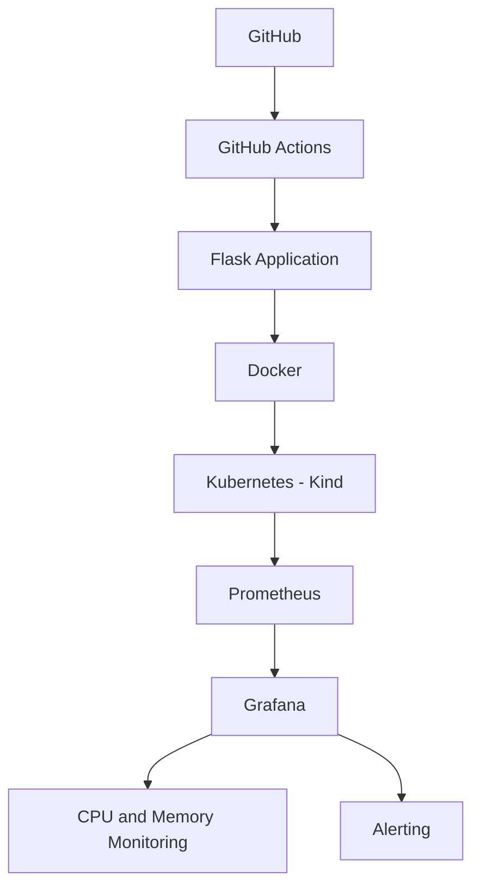

# Real-Time DevOps Monitoring System

An end-to-end DevOps monitoring project demonstrating application
containerization, Kubernetes deployment, metrics collection,
visual monitoring, CI, and alerting.

## 🚀 Project Overview

This project deploys a Flask application using Docker and Kubernetes
and monitors application CPU and memory usage using Prometheus and Grafana.

The project demonstrates a complete DevOps workflow from application
development and CI to containerization, Kubernetes deployment,
monitoring, and alerting.

## 🏗️ Architecture



## 🛠️ Technologies Used

- Python
- Flask
- Docker
- Kubernetes
- Kind
- Prometheus
- Grafana
- GitHub Actions
- PowerShell

## 📊 Monitoring

The application exposes Prometheus metrics through:

`/metrics`

Metrics include:

- CPU usage
- Memory usage

Prometheus periodically collects these metrics and Grafana visualizes
the collected data in real time.

## 🚨 Alerting

A Grafana alert was configured for high CPU usage.

Alert condition:

`CPU usage > 80%`

The alert lifecycle was tested successfully:

**Normal → Firing → Normal**

This confirms that the monitoring and alerting workflow is working
as expected.

## 🔄 CI

GitHub Actions is used for Continuous Integration.

The workflow automatically runs when code is pushed to the `main`
branch or when a pull request is created.

The CI pipeline:

1. Checks out the repository
2. Sets up Python
3. Installs project dependencies
4. Checks the Flask application using Python compilation

## 🐳 Docker

The Flask application is containerized using Docker.

Docker provides a consistent environment for running the application
and makes the application portable across environments.

## ☸️ Kubernetes

The application is deployed to a local Kubernetes cluster using Kind.

Kubernetes resources include:

- Deployment
- Service
- Liveness probe
- Readiness probe

The application health is monitored through the `/health` endpoint.

## 📈 Grafana

Grafana is used to visualize application metrics collected by
Prometheus.

The monitoring dashboard includes:

- CPU usage
- Memory usage

Grafana alerting is also configured to detect high CPU utilization.

## 🔍 Prometheus

Prometheus collects metrics from the Flask application's `/metrics`
endpoint.

The Prometheus configuration defines the application as a monitoring
target and periodically scrapes its metrics.

## 🧪 Testing

The monitoring system was tested end-to-end:

- Flask application running successfully
- Docker image built successfully
- Kubernetes deployment running successfully
- Prometheus target showing `UP`
- CPU and memory metrics visible in Grafana
- Grafana alert tested from **Normal → Firing → Normal**

## 📁 Project Structure

```text
Real-Time-DevOps-Monitoring/
│
├── .github/
│   └── workflows/
│       └── ...
│
├── app.py
├── deployment.yaml
├── service.yaml
├── Dockerfile
├── prometheus.yml
├── requirements.txt
├── .gitignore
└── README.md
```

## 🎯 Project Goals

The main goals of this project are to understand and demonstrate:

- Application development with Flask
- Git and GitHub workflow
- Continuous Integration with GitHub Actions
- Containerization with Docker
- Kubernetes deployment
- Application health checks
- Metrics collection with Prometheus
- Monitoring with Grafana
- Alerting based on application metrics

## 🔄 DevOps Workflow

```text
Code
  ↓
GitHub
  ↓
GitHub Actions
  ↓
Docker
  ↓
Kubernetes
  ↓
Prometheus
  ↓
Grafana
  ↓
Monitoring
  ↓
Alerting
```

## 📌 Conclusion

This project demonstrates how application development,
containerization, orchestration, continuous integration,
monitoring, and alerting can be combined into an end-to-end
DevOps workflow.

## 👩‍💻 Author

**Nirali Khavariya**